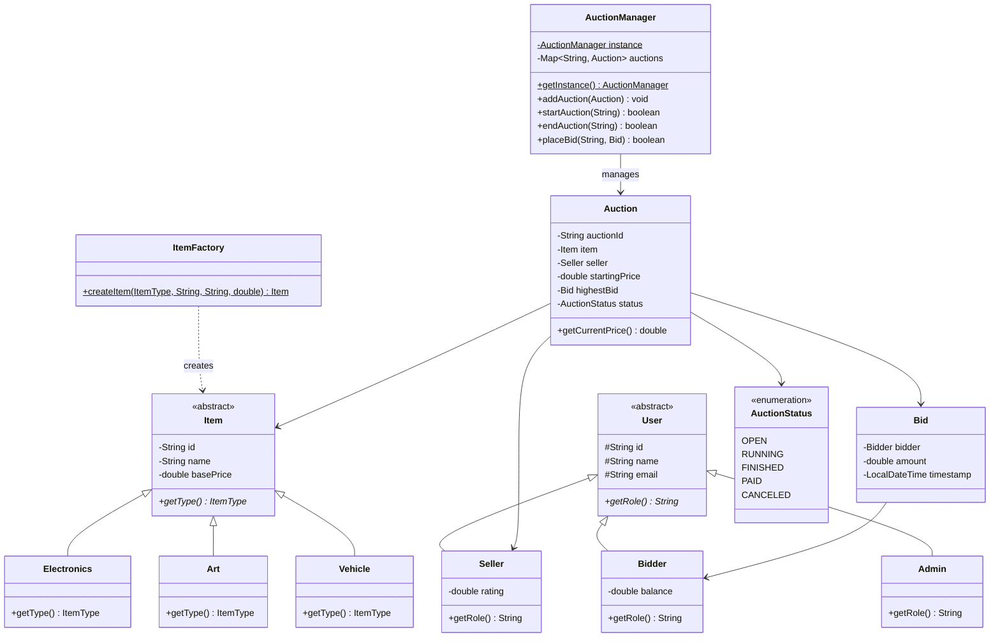

# Hệ thống Đấu giá Trực tuyến (Online Auction System) — LTNC 2026

Dự án Bài tập lớn môn **Lập trình nâng cao (HKII 2025–2026)** xây dựng theo kiến trúc **Client–Server (Socket)**, **JavaFX (MVC)** và **Maven Multi-module**.

## 1. Cấu trúc Module
- **`auction-common`**: Chứa các lớp Model OOP (`User`, `Item`, `Auction`, `Bid`, `AuctionStatus`) và `ItemFactory` (Factory Method Pattern).
- **`auction-server`**: Chứa `AuctionManager` (Singleton Pattern, Thread-safe `synchronized`), xử lý đấu giá và demo Socket/Concurrency (`EchoServer`, `EchoClient`, `RaceConditionDemo`).
- **`auction-client`**: Ứng dụng giao diện `JavaFX + FXML + CSS` (Màn hình `Login` và `Auction List`).

## 2. Sơ đồ lớp (Class Diagram - Tuần 6)

## 3. Hướng dẫn chạy dự án
- **Chạy Unit Test (JUnit 5):** `mvn clean test`
- **Chạy Giao diện Client (JavaFX):** Chạy hàm `main` trong `com.auction.client.Launcher`
- **Chạy Demo Đa luồng & Socket (Tuần 6):** Chạy `EchoServer`, `EchoClient` và `RaceConditionDemo` trong `auction-server`.